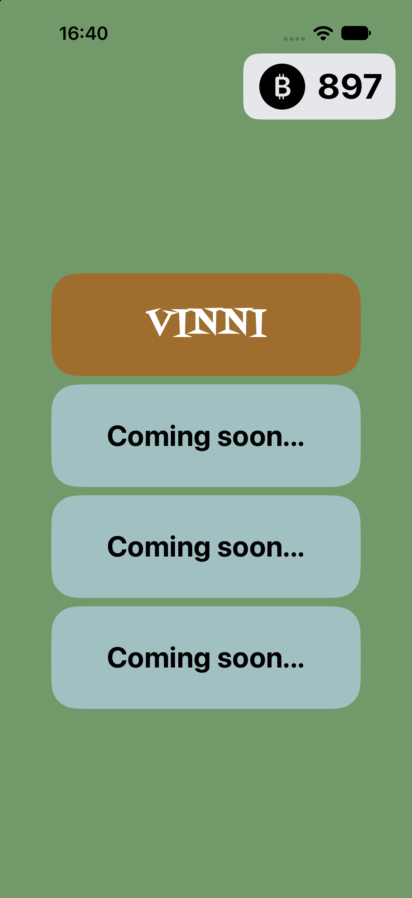
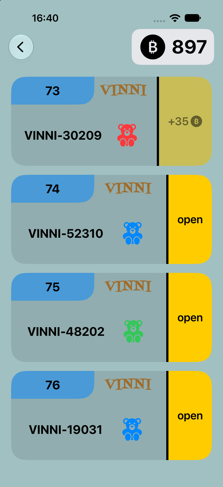

# ZeroLoss

A SwiftUI iOS app that simulates lottery tickets. The user "buys" the **VINNI** lottery with 100,000 tickets, opens them, and adds the winnings to their balance.

## Screenshots

  
  

## Features

- Generates 100,000 tickets on a background thread and stores them in Realm
- Ticket list (`List`) with instant UI updates when a ticket is opened
- User balance (starts at 100), persisted in `UserDefaults`
- Balance widget in the toolbar (on iOS 26, without the shared Liquid Glass background)
- Custom `Fontdiner Swanky` font

## Requirements

| | Minimum |
|---|---|
| **Xcode** | **27.0** |
| iOS (deployment target) | 18.0 |
| Devices | iPhone |
| Swift | 5 |

> The project uses the new JSON project file format `ZeroLoss.xcodeproj/project.xcproj`, created in Xcode 27. Older Xcode versions cannot open it.

## Dependencies

Resolved automatically via Swift Package Manager:

- [realm-swift](https://github.com/realm/realm-swift) `20.0.6`+ (up to next major version)

## Getting Started

1. Clone the repository.
2. Open `ZeroLoss.xcodeproj` in Xcode 27+.
3. Wait for SPM packages to resolve.
4. If needed, set your team in **Signing & Capabilities** (`DEVELOPMENT_TEAM` is empty).
5. Select an iPhone simulator and press **Run** (⌘R).

## Author

[KeeRReeK](https://github.com/KeeRReeK)

## License

[MIT](LICENSE)
